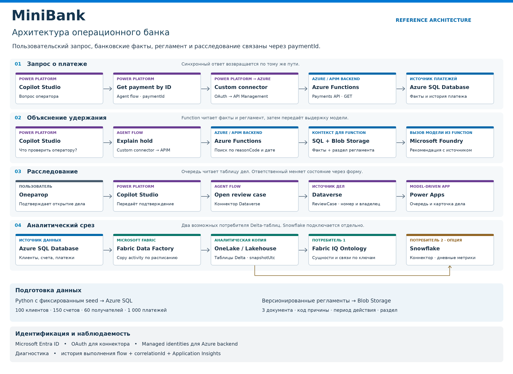
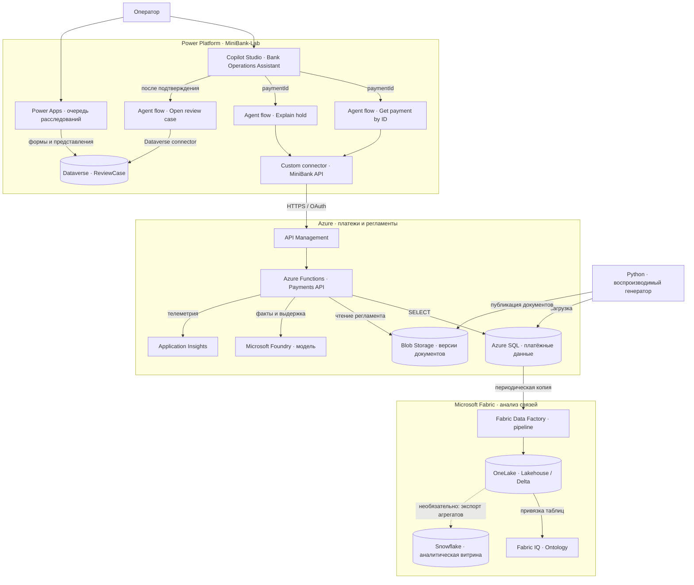

# MiniBank · Архитектура операционного банка

**Решение для учебного tenant · Версия 1.0 · 20 ноября 2026**

Оператор получает вопрос «Почему задержался PAY-1042?». Ему нужны три разных ответа: что случилось с деньгами, что предписывает регламент и кто уже занимается вопросом. В этом дизайне за первый ответ отвечает платёжный сервис в Azure, за второй — утверждённые документы и модель в Microsoft Foundry, за третий — карточка расследования в Dataverse. Общий ключ между ними — публичный идентификатор платежа.

**Граница проекта.** MiniBank моделирует работу операционного подразделения после поступления платежа. Платежи и их история генерируются заранее. Исполнение переводов, бухгалтерский ledger, KYC и подключение к платёжным сетям находятся за пределами модели. Это вымышленный банк, без предположений об архитектуре Citi.

## Архитектура целиком

PNG и этот документ можно скачать в одну папку. Ниже та же архитектура в редактируемом Mermaid. Стрелки в операционной части показывают вызовы, в аналитической — перенос или привязку данных. Ответ синхронного вызова возвращается вызывающей стороне.

Entra ID используется для идентификации пользователей и сервисов. Power Platform admin center управляет средой, доступом и ёмкостью. Администратор подписки управляет ресурсами Azure. Эти административные действия не участвуют в каждом запросе оператора.

## Кто за что отвечает

| Компонент | Что делает для банка | С кем и как связан |
|---|---|---|
| Copilot Studio, существующий Standard agent | Принимает вопрос, извлекает ID, выбирает действие, объясняет ответ. | Вызывает три именованных инструмента. Статус и причина всегда берутся из результата поиска. |
| Agent flows | Задают входы, последовательность вызовов и структурированные выходы. Создание дела выполняется отдельным действием после подтверждения. | Триггер **When an agent calls the flow**, действия коннектора, **Respond to the agent**. |
| Custom connector + Azure API Management | Один описывает операции API для Power Platform, другой принимает запросы в Azure и применяет политики доступа. | OpenAPI с операциями поиска и объяснения; OAuth через Entra ID. Для выходных достаточно одного API. [Интеграция APIM с Power Platform](https://learn.microsoft.com/en-us/azure/api-management/export-api-power-platform) |
| Azure Functions + Azure SQL Database | Платёжная команда владеет бизнес-контрактом и источником фактов. Function читает по параметризованному запросу и собирает факты и историю. | APIM → Function → SQL. Managed identity функции получает SELECT на нужные представления. |
| Blob Storage + Microsoft Foundry | Банк изменяет регламент независимо от кода. Foundry предлагает оператору следующий шаг по подходящей версии регламента. | Function выбирает документ по reasonCode и дате действия, передаёт выдержку и платёжные факты в развёрнутую модель; возвращает ID, версию и раздел источника. |
| Dataverse + Power Apps | В Dataverse хранится состояние работы людей. В model-driven app руководитель видит очередь дел, назначает ответственного и закрывает дело. | Действие **Microsoft Dataverse** открывает дело. Формы и представления Power Apps работают с той же таблицей. [Model-driven apps](https://learn.microsoft.com/en-us/power-apps/maker/model-driven-apps/model-driven-app-overview) |
| Fabric Data Factory, OneLake, Fabric IQ Ontology | Аналитик исследует связи между клиентом, счетами, платежами и получателями. Отдельная копия даёт повторяемый срез для анализа. | Pipeline копирует таблицы SQL в Delta; ontology связывает сущности с таблицами Lakehouse. Для preview заранее проверить доступность, capacity и tenant settings. [Привязка данных к ontology](https://learn.microsoft.com/en-us/fabric/iq/ontology/how-to-bind-data) |
| Snowflake · опция | Группа аналитики уже использует Snowflake и хочет дневные показатели задержек. | После первого среза pipeline выгружает агрегаты из Lakehouse через Snowflake connector. [Коннектор Fabric](https://learn.microsoft.com/en-us/fabric/data-factory/connector-snowflake-overview) |

**Где что открывать.** [Copilot Studio](https://copilotstudio.microsoft.com/) — агент, инструменты и трассировка диалога. [Power Apps](https://make.powerapps.com/) — таблицы Dataverse, формы, приложение оператора и solution. [Power Platform admin center](https://admin.powerplatform.microsoft.com/) — среда MiniBank-Lab и capacity. [Foundry](https://ai.azure.com/) — модель и её deployment. [Fabric](https://app.fabric.microsoft.com/) — workspace, Lakehouse, pipeline и ontology. Для первой сборки также понадобятся действующая ёмкость для тестовых вызовов агента, доступ к выбранной модели и, для аналитического этапа, Fabric capacity. Работоспособность существующего агента подтверждена только для текущего теста пользователя.

## Один платёж от вопроса до закрытия дела

1. **Получить факт.** Оператор спрашивает про PAY-1042. Агент передаёт ID в существующий инструмент **Get payment by ID**. Его новая реализация вызывает `GET /payments/{paymentId}`. Минимальный результат — `found`, `paymentId`, `status`, `reasonCode`, `holdReason`, `asOfUtc`. Для неизвестного ID API возвращает 404, flow преобразует его в `found=false`. Таймаут или запрет доступа возвращается как ошибка сервиса.
2. **Объяснить действие.** На вопрос «Что проверить?» инструмент **Explain hold** вызывает `GET /payments/{paymentId}/guidance`. Function заново читает факты и выбирает действующий раздел регламента. Для PAY-1042 модель получает только состояние, код причины и нужную выдержку. Выход — рекомендация и ссылка на конкретную версию раздела. Если подходящего регламента нет, инструмент сообщает об этом и предлагает ручную проверку.
3. **Открыть дело.** Агент показывает ID и причину, запрашивает подтверждение. После согласия **Open review case** выполняет операцию в Dataverse и возвращает `caseNumber`. Для MVP одно дело на платёж за всю историю, включая закрытые. Alternate key по `paymentId` обеспечивает уникальность при параллельных запросах. При конфликте flow читает существующую запись и возвращает её номер, сохраняя владельца и состояние.
4. **Продолжить работу.** Сотрудник видит запись в очереди Power Apps, назначает владельца, добавляет результат проверки и закрывает дело. Статус расследования и статус денег имеют разных владельцев. Закрытие дела само по себе не меняет платёж.
5. **Найти закономерность.** На последнем аналитическом срезе аналитик задаёт другой вопрос: «У каких клиентов несколько счетов отправляли задержанные платежи одному получателю?» Для этого нужны связи и история многих платежей, а также отметка времени среза. По одному онлайн-вызову оператора такой вывод сделать нельзя.

## Синтетические данные и место хранения

Начальный объём выбран для сборки за выходные. Генератор Python принимает `seed=42` и фиксированный `asOfUtc=2026-11-20T12:00:00Z`. Сначала создаёт справочники и связи, затем историю событий, в конце вычисляет текущее состояние платежа по последнему событию. Те же параметры воспроизводят те же строки. Для денежных сумм используется decimal(19,4), для времени — UTC. Начальная валюта USD.

| Набор | Объём MVP | Ключи и важные поля | Владелец и размещение |
|---|---:|---|---|
| Customer | 100 | customerId, вымышленный alias, segment | Azure SQL, затем копия в Lakehouse |
| Account | 150 | accountId, customerId → Customer, currency | Azure SQL → Lakehouse |
| Beneficiary | 60 | beneficiaryId, вымышленный alias, countryCode | Azure SQL → Lakehouse |
| Payment | 1 000 | paymentId, accountId, beneficiaryId, amount, currency, createdUtc, status, reasonCode, holdReason, asOfUtc | Azure SQL → Lakehouse |
| PaymentEvent | 2–4 на платёж | eventId, paymentId, sequenceNo, eventUtc, status, reasonCode | Azure SQL → Lakehouse |
| PolicyDocument | 3 Markdown-документа | policyId, version, reasonCode, validFromUtc, validToUtc, sectionId | Blob, путь policies/{reasonCode}/{version}.md; индекс версий — manifest.json |
| ReviewCase | 0 при старте | GUID Dataverse, caseNumber (autonumber), paymentId (alternate key), owner, caseStatus, openedUtc, resolution | Dataverse; связь с SQL по paymentId через приложение |
| DailyHoldMetrics | По дню, валюте и причине | dayUtc, currency, reasonCode, heldCount, heldAmount, snapshotUtc | Производная Delta-таблица; опциональная копия в Snowflake |

**Правила генерации.** Использовать вымышленные ID и псевдонимы, без реальных реквизитов. Задать переходы Submitted → Processing → Settled либо Submitted → On hold → Processing → Settled; часть платежей заканчивается на On hold. У текущего удержания есть причина, после снятия удержания причина остаётся в истории. Вставить устойчивый аналитический пример — два счёта одного клиента с задержками у одного получателя. При повторной загрузке использовать staging и обновление по стабильным ключам. Единица дневной метрики — платёж, остававшийся на удержании на конец соответствующего дня по UTC; повторный расчёт заменяет записи за этот день.

**Контрольный платёж.** Закрепить PAY-1042 за отдельной строкой генератора: USD 250.00, status = **On hold**, reasonCode = **BEN_VERIFICATION**, holdReason = **Beneficiary details pending verification**. В показанном результате старого инструмента значения status и holdReason поменяны местами. До переключения на SQL исправить тестовую строку Dataverse и сравнить оба поля по имени в сыром ответе. Старую таблицу Lab Payments оставить только как тестовый образец. Рабочий инструмент получает платежи из SQL.

**Онтология.** Customer → owns → Account → sends → Payment → pays → Beneficiary. Payment → hasEvent → PaymentEvent. Ключ сущности задаётся соответствующим ID, связи строятся по внешним ключам SQL, перенесённым в Delta. Первый прогон обновляет весь срез и записывает snapshotUtc. В MVP агент не читает ontology: для ответа о текущем платеже он вызывает API. Онтология доступна отдельно аналитику.

## Доступ, эксплуатация и проверка

- **Граница доступа.** В первой версии все операторы состоят в одной тестовой группе MiniBankOps с доступом ко всем синтетическим платежам. Коннектор использует делегированный OAuth; APIM проверяет токен, audience и scope. Function backend принимает вызов APIM по выделенной identity; доступ к SQL, Blob и модели ограничен отдельными разрешениями identity функции. Для данных дел назначаются Dataverse security roles. Проверять доступ именно под вторым пользователем.
- **Диагностика.** Flow передаёт correlationId в API. В Application Insights пишутся операция, ID корреляции, длительность и результат. Исполнение проверяется по истории flow, ответ модели — по ID версии источника. Полные промпты и строки платежей в телеметрии не нужны.
- **Расходы и срок жизни.** Trial среды Power Platform, Copilot Credits, Fabric capacity и потребление Foundry учитываются отдельно. Сохранить solution с агентом, flows, custom connector, connection references, схемой дела и приложением. Данные SQL воспроизводятся генератором, тестовые дела при необходимости экспортируются отдельно. Для выходных измерить расходы Azure по отдельной resource group.

| Этап | Что собрать | Приёмочный тест |
|---|---|---|
| 1 · Платёжный сервис | Генератор, SQL, Function, APIM, custom connector. В существующем flow заменить Dataverse List rows на API. | PAY-1042 возвращает точные status и holdReason. PAY-UNKNOWN даёт «платёж не найден». При отключении API агент сообщает о недоступности данных. |
| 2 · Рабочее место | ReviewCase, Open review case и очередь Power Apps. | До подтверждения очередь пуста. После двух подтверждений по одному ID видна одна запись с одним номером. |
| 3 · AI | Три регламента, deployment модели в Foundry и Explain hold. | Объяснение ссылается на раздел действующей версии. Удаление подходящего документа приводит к сообщению об отсутствии инструкции. |
| 4 · Аналитика | Скопировать SQL в Lakehouse, привязать сущности и отношения в ontology. Snowflake включать при наличии отдельного сценария потребления. | Найти специально сгенерированную пару счетов. Для одного дня сверить число удержаний и сумму между SQL-событиями и витриной. |

**Рабочая цель на выходные — этапы 1–3.** Они дают демонстрацию полного обращения, от исходных данных до зарегистрированного дела. Этап 4 можно собирать независимо, как только появился воспроизводимый набор SQL. Платный SKU для этапов дизайном не фиксируется.
